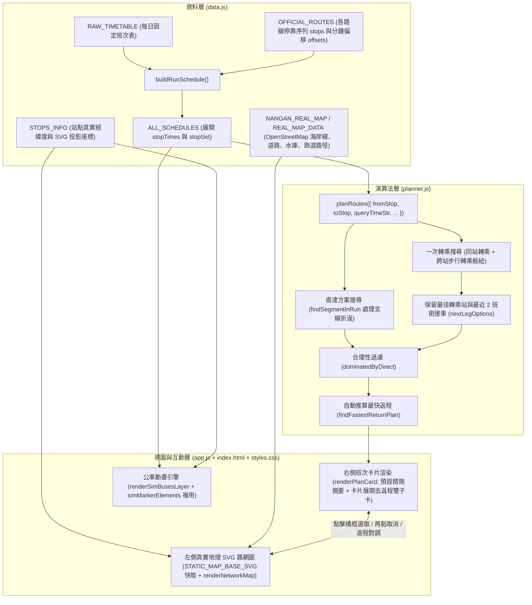

# 🚌 區域公車動態路線查詢與路網動畫系統 — 通用架構與移植規格書

本專案為純前端（Vanilla HTML / CSS / JavaScript，無外部框架與後端依賴）打造的 **區域公車智慧路線規劃、雙向時刻表查詢與即時路網動畫系統**。
本文件採用 **去識別化（Region-Agnostic）** 規格撰寫，完整定義所有功能模組、資料結構介面、演算法邏輯與 UI/UX 互動細節，供後續 AI Agent 或開發者將整套功能無縫移植至任何城市、鄉鎮或島嶼的公車路網。

---

## 1. 核心功能規格總覽（Feature Specifications）

系統專為「多主幹路線 + 多支線繞行 + 固定班表排點」的區域公車路網設計，包含以下 6 大核心模組：

### 1.1 頂部導覽列（`.top-header`）
- **品牌標題**：顯示系統名稱與圖示（單列不換行 `.header-inner { flex-wrap: nowrap }`，窄螢幕自動微調字級與內距以保持單行顯示）。
- **右側操作按鈕組（`.header-actions`）**：採用統一低調的深色半透明邊框按鈕風格（`.btn-header`）：
  1. **`🚌 官方動態系統`**：外連至官方公車動態網站（`target="_blank"`）。
  2. **`📄 原始時刻表`**：外連開啟官方紙本時刻表圖片 `timetable.png`（`target="_blank"`）。

### 1.2 智慧查詢控制面板（`.planner-control-card`）
- **起點（`#from-stop`）與終點（`#to-stop`）選單**：
  - 依「路線區段／支線群組」使用 `<optgroup>` 分類顯示。
  - 支援為特定站點附加括號地標／俗名提示（設定於 `SHORT_HINT` 對照表）。
  - 支援透過 URL Query（`?from=起點&to=終點`）指定初始站點，若無則套用預設起點（如總站 A）與預設終點（如總站 B）。
- **起訖互換按鈕（`#swap-stops-btn`）**：點擊 `⇄` 一鍵對調起點與終點並重新計算路線。
- **班次顯示範圍切換（`.time-scope-switch`）**：
  - **`尚未發車`（`#scope-upcoming-btn`）**：讀取使用者系統現在時間（`new Date()`），僅列出尚未從起點發車的班次。
  - **`整天`（`#scope-allday-btn`）**：從 `00:00` 起列出全日所有可行班次。
  - **夜間自動切換規則（`getDefaultTimeScope`）**：每日 **19:00（含）之後** 開啟網頁，預設自動選取 `整天`；19:00 前預設選取 `尚未發車`。
- **篩選勾選（`.filter-toggles`）**：
  - `含轉乘方案`（`#filter-transfer`，預設勾選）：控制是否計算並顯示一次轉乘方案。
  - `♿ 無障礙`（`#filter-accessible`）：僅篩選無障礙公車班次。

### 1.3 右側推薦班次卡片列表（`#route-results`）
- **橘色高亮框選取與取消機制（`.plan-card.selected-card`）**：
  - **預設不選取**：初始載入、切換起訖站或更改篩選條件時，預設不選取任何卡片（`selectedIdx = -1`, `state.highlightedPlan = null`），地圖保持顯示乾淨完整路網。
  - **點擊選取 ／ 再點取消**：點擊任一張班次卡片會加上橘色外框（`.selected-card`），並在左側地圖高亮顯示該方案的橘色動態行進路線；**再次點擊已選取的橘框卡片（或詳細模式中已選取的子卡），即可取消橘框並清除地圖路線高亮**。
- **預設精簡摘要列（Simple Row）**：
  - 以單行精簡呈現：`出發時間 ➔ 抵達時間`、`總行車分鐘數`、`直達` 或 `🔄 轉乘（轉乘站）` 標籤。
  - 顯示可點擊的班次膠囊（`.run-route-btn`，包含線別色塊、總站發車時間、無障礙圖示）。點擊單一班次膠囊可於地圖單獨預覽該班次由起點總站至終點總站的完整行駛軌跡（含支線折返）。
  - 卡片右下角提供 `詳細 ▾ ／ 收合 ▴` 按鈕（`.toggle-detail-btn`）可單獨展開或收合該卡片的詳細區塊。
- **展開詳細區塊（`.card-detail-section`）—「去程 ／ 返程」雙子卡架構**：
  - 展開區塊包含上下兩張獨立子卡片（`.trip-subcard`）：
    1. **上方「去程」子卡（`data-trip-dir="outbound"`）**：
       - 預設為選取狀態（`.active-subcard`，藍色狀態圓點）。
       - 顯示各段搭乘班次、支線色點徽章、特殊行駛提醒、上下車時間，以及可展開的 **沿途停靠站時間軸（`.stops-timeline-drawer`）**。
       - **轉乘銜接班次切換器（`.transfer-opt-btn`）**：若為轉乘方案，自動列出在轉乘站可銜接的 **最近 2 班第二段公車**（顯示發車時間与候車分鐘數），點擊可即時切換第二段搭乘班次並更新總抵達時間與地圖路線。
    2. **下方「返程」子卡（`data-trip-dir="return"`）**：
       - 自動根據去程抵達終點的時間（`arrTimeMin`），推算抵達後最快可搭乘的反向回程方案（`plan.fastestReturn`）。
       - 未選取時呈現灰階半透明（`.inactive-subcard`）；點擊返程子卡可將其切換為選取狀態，並讓左側地圖同步切換顯示返程路線。
       - **返程一鍵反查按鈕（`.switch-route-dir-btn`）**：返程子卡標題列設有 **`[終點站 ➔ 起點站]`** 按鈕，點擊後會將主查詢的起點與終點對調，並將橘色高亮框（`.selected-card`）自動定位且平滑捲動至對應的那一班返程卡片。

### 1.4 左側真實地理向量互動路網圖（`#network-map-card`）
- **響應式排列順序（`.workspace-grid`）**：桌機寬螢幕時採左路網圖、右方案列表雙欄並排（`1.05fr 1fr`）；當畫面較窄（`<= 1024px` 單欄模式）時，路網圖自然排在方案列表上方，方便先看圖點選站點或公車動畫，再向下瀏覽推薦班次。
- **OpenStreetMap 真實地理投影底圖**：
  - 將目標區域的 OpenStreetMap 真實海岸線／行政區邊界多邊形（`coastlinePath`）、主要道路網（`roadPaths`）、水域／水庫（`waterPaths`）與地標設施（如機場跑道 `runwayPaths`）透過 Mercator 投影轉換為 SVG 向量路徑，搭配地形等高線暈染與指北針，作為路網圖背景。
  - 所有公車站點皆依真實世界 GPS 經緯度（`lat`, `lon`）透過相同投影公式計算出 `(x, y)` 座標，並透過站點文字偏移表（`LABEL_OFFSETS`）錯開密集站點的文字標籤。
- **右上角一體式工具膠囊組（`.map-overlay-actions`）**：
  - 位於地圖右上角，將 **`▶ 公車動畫`**（`#map-sim-btn`）與 **`⛶ 全螢幕`**（`#map-fullscreen-btn`）整合為一體式深色毛玻璃雙按鈕組（中間以細線分隔，共享單色圖示風格與藍色啟用高亮）。
  - 點擊 **`⛶ 全螢幕`** 可將整個地圖卡片（含 SVG 地圖與下方動畫控制列）透過 CSS `.map-card-fullscreen` 切換為全視窗滿版檢視（支援 `Esc` 鍵退出，不觸發瀏覽器原生 `requestFullscreen()` 的系統退出提示橫幅），全螢幕下會自動隱藏上方「點擊站點設為：」工具列（`.map-toolbar`）。
  - **手機直立自動橫螢幕（電腦縮窄不旋轉）**：透過 `@media (max-width: 900px) and (orientation: portrait) and (hover: none) and (pointer: coarse)` 精準鎖定純觸控行動裝置，在手機直立進入全螢幕時自動以 CSS `rotate(90deg)` 轉為橫螢幕滿版顯示（並由 `handleRotatedSliderTouch` 支援旋轉座標下的時間軸觸控拖曳）；電腦端即使將瀏覽器視窗縮窄也不會旋轉。
- **左上角圖例與一鍵取消高亮**：
  - 顯示路線顏色圖例；當有任何路線處於高亮狀態時，圖例右側自動浮現橘色 **`✕ 取消路線顯示`** 按鈕（`#clear-map-highlight-btn`），點擊即可清除選取。
- **點擊地圖站點設為起／終點**：
  - 地圖上方工具列提供 `起點`（`#map-mode-from`）與 `終點`（`#map-mode-to`）模式切換；點擊地圖上的站點圓圈即可直接指派起訖站，並在指派後自動交替切換模式。

### 1.5 公車動畫模擬引擎（`#sim-control-bar`）
- **版面配置**：置於地圖正下方（`.svg-wrapper` 下方），時間資訊與控制按鈕列皆採水平置中對齊（`justify-content: center`）。
- **開啟預設狀態**：點擊 `公車動畫` 開啟時，**預設讀取當下系統時間 (`new Date()`) 並保持暫停狀態 (`simPlaying = false`)**。
- **控制列功能**：
  - **時間與狀態顯示**：顯示狀態燈號（播放時綠燈脈衝、暫停時橘燈）、當前模擬時間 `HH:MM:SS`（`#sim-clock-text`）與當下行駛中公車數量 `行駛中 X 輛`（`#sim-active-count`）。
  - **`▶ 播放 / ⏸ 暫停`（`#sim-play-btn`）**：
    - 若按下播放時，當前模擬時間不在營運時間軸範圍（最早班次發車 ～ 最晚班次到站）內，自動跳至 **最早班次發車時間** 開始播放。
    - 若當前時間已在範圍內，則直接從所選時間點連續平滑推進。
  - **`🕒 現在時間`（`#sim-now-btn`）**：一鍵重設回當下系統時間並暫停。
  - **倍速切換（`[data-speed]`）**：提供 **`50X`**、**`100X`**（預設）、**`200X`** 三段倍速。
  - **營運時間軸滑桿（`#sim-time-slider`）**：透過 `getScheduleTimeBounds()` 動態計算全天 **最早班次發車時間** 至 **最晚班次發車時間 + 1 小時（60 分鐘）**（例如 `06:20 ～ 19:05`，確保末班車完整走完），自動設定滑桿 `min`、`max` 與左右端點時間標籤，支援隨時拖曳預覽任意時刻的全區公車分佈。
- **公車移動插值與終點站標籤**：
  - 根據班次各站到站時間 `stopTimes`，找出當前時間 `simMin` 所在的相鄰兩站 `[stA, stB]`，以線性插值計算公車即時座標 `(x, y)`。
  - 公車標籤顯示 **`[線別 發車時間 ➔ 終點站]`**，點擊移動中的公車圖示可直接在地圖上高亮顯示該班次的完整行駛路線。
- **60fps 零卡頓 DOM 複用機制（`simMarkerElements` & `simDom`）**：
  - 預先於 `simDom` 快取時間與計數器 DOM 節點，並以記憶體 `simMarkerElements`（`Map`）直接依 `run.id` 追蹤 `#sim-buses-layer` 中的 `<g class="sim-bus-marker">` 節點：60fps 播放時零 DOM 查詢（無須每幀呼叫 `getElementById` 或 `querySelectorAll`），已在場上的公車每幀僅更新 `transform="translate(x, y)"` 屬性，不重建 `innerHTML`，避免脈衝動畫重置與 DOM 抖動。
  - 公車標籤上下偏移量（`labelOffsetY`）依班次行駛方向固定（去程在上方 `-24`、返程在下方 `+28`），避免因其他公車發車加入或到站移除而造成標籤上下跳動。

### 1.6 摺疊式完整雙向時刻表與支線圖例（`.section-collapse`）
- 頁面底部提供預設收合的 `<details>` 面板，展開後顯示所有支線色點圖例卡片，以及支援依「線別」、「支線」與「無障礙」即時篩選的雙向完整時刻表（點擊「站點」可開啟 `#run-detail-modal` 檢視該班次完整停靠時間軸，支援 `Esc` 鍵關閉）。

---

## 2. 系統架構與資料流圖



---

## 3. 移植至新地區之資料介面規格（Porting Guide）

若要將本系統移植至其他地區或城市，僅需替換 `data.js` 中的資料並調整 `app.js` 的路網連線，其餘 `planner.js`、`index.html`、`styles.css` 架構皆可直接沿用：

### 步驟 1：準備地理底圖向量（`NANGAN_REAL_MAP` / `REAL_MAP_DATA`）
1. 從 OpenStreetMap（Overpass API）擷取目標區域的邊界／海岸線、主要道路（`highway=primary|secondary|tertiary`）與水域（`natural=water`）。
2. 設定目標區域經緯度邊界 `[minLon, maxLon, minLat, maxLat]`，透過 Mercator 比例投影至 `1000 x 540` 畫布：
   ```js
   function project(lon, lat) {
     const x = PADDING_X + ((lon - minLon) / (maxLon - minLon)) * DRAW_WIDTH;
     const y = (HEIGHT - PADDING_Y) - ((lat - minLat) / (maxLat - minLat)) * DRAW_HEIGHT;
     return [Number(x.toFixed(1)), Number(y.toFixed(1))];
   }
   ```
3. 將轉換後的 SVG Path 字串存入 `coastlinePath`、`roadPaths`、`waterPaths`、`runwayPaths`（由 `app.js` 啟動時預先建構為 `STATIC_MAP_BASE_SVG` 快取）。

### 步驟 2：定義站點資訊（`STOPS_INFO`）
依各站真實經緯度透過上述 `project(lon, lat)` 算出 `x, y`，結構如下：
```js
const STOPS_INFO = {
  "站點名稱": {
    group: "分區或支線群組名稱", // 供下拉選單 <optgroup> 分類
    landmark: "地標說明",
    x: 691, y: 296,             // SVG 座標
    lat: 26.1554, lon: 119.9518,// 真實經緯度
    hub: true,                  // 是否為主要轉乘站／總站（圓點較大）
    line: "主線代號",            // 例如 "山" / "海"（決定站點外框顏色，共線段可省略）
    branch: "支線ID"            // 對應 BRANCHES 的鍵值（決定支線站點填色）
  }
};
```

### 步驟 3：定義路線排點與班表（`OFFICIAL_ROUTES` & `RAW_TIMETABLE`）
1. **`OFFICIAL_ROUTES`**：定義每種行駛路線代碼 `rid` 的停靠站序列 `stops[]` 與相對發車時間的累加分鐘數 `offsets[]`。
   - **重要規範**：相鄰兩站的 `offsets` 必須嚴格遞增（差值 `>= 1` 分鐘），不可出現連續多站相同偏移量，以確保公車動畫在站與站之間平滑移動。
2. **`RAW_TIMETABLE`**：定義每日各班次的發車時間 `time`（`"HH:MM"`）、方向 `dir`、主線別 `line`、對應路線 `rid`、途經支線陣列 `branches[]` 與無障礙標記 `accessible`。

### 步驟 4：設定轉乘規則與路網拓撲（`planner.js` & `app.js`）
1. **跨站步行轉乘樞紐（`planner.js`）**：
   - 預設支援所有同站轉乘（最小緩衝 `1` 分鐘）。
   - 若新地區有相鄰可步行的跨線轉乘站（如同本專案的「梅石 ↔ 清水」），於 `planner.js` 的轉乘候選迴圈中設定對應站名與跨站步行緩衝分鐘數（`3` 分鐘）。
2. **路網圖連線拓撲（`app.js` 的 `NETWORK_EDGES` 與 `LABEL_OFFSETS`）**：
   - 於 `app.js` 頂層常數 `NETWORK_EDGES` 陣列定義相鄰站點連線 `{ a: "站A", b: "站B", type: "common" | "mtn" | "sea" | "branch" | "transfer" }`，以及在頂層常數 `LABEL_OFFSETS` 微調密集站點的文字偏移 `[dx, dy]`。

---

## 4. 演算法關鍵細節備忘（AI 重現必讀）

1. **支線折返重複停靠處理與快速查找（`findSegmentInRun` & `stopSet`）**：
   - `buildRunSchedule()` 會預先為每班次建立 `stopSet: new Set(stops)` 進行 $O(1)$ 站點存在性過濾。
   - 公車進入支線折返時，同一班次的 `stops[]` 會出現兩次相同站名（例如 `主幹站A ➔ 支線站B ➔ 支線端點C ➔ 支線站B ➔ 主幹站A ➔ 主幹站D`）。
   - 搜尋起訖站時**絕對不可使用 `indexOf`**，必須找出所有符合的起點索引 `i` 與終點索引 `j`（`i < j`），並選擇站距跨度 `j - i` 最短的區間，避免讓乘客提早搭上車卻跟著繞進支線再出來。
2. **轉乘合理性過濾（`dominatedByDirect`）**：
   - 當某直達班次在轉乘方案出發前後 2 分鐘內發車且更早（或同時）抵達終點時，自動過濾掉該轉乘方案；同時檢查第一段與第二段內部停靠站是否重疊（`hasBacktrack`），避免坐過頭再折返的無效轉乘。
3. **返程切換定位橘框（`updatePlannerAndUI(preferredPlan)`）**：
   - 當使用者點擊返程子卡的 `[終點 ➔ 起點]` 按鈕時，將 `targetPlan.fastestReturn` 作為 `preferredPlan` 傳入 `updatePlannerAndUI(preferredPlan)`，比對 `depTimeMin` 與 `run.id` 自動選中該班次並加上 `.selected-card` 橘框且捲動至可視範圍。

---

## 5. 檔案結構與啟動方式

```text
project-root/
├── index.html      # 頁面骨架（頂部列、查詢面板、左側地圖與下方動畫控制列、右側方案列表、底部完整時刻表）
├── styles.css      # 完整樣式（CSS 變數、去返程子卡片、橘框高亮、一體式地圖按鈕組、手機橫向全螢幕、脈衝動畫）
├── data.js         # 區域資料庫（GEO 投影路徑、站點座標、支線定義、路線排點 offsets、班次表）
├── planner.js      # 路線規劃核心（stopSet 加速、直達、同站/跨站轉乘、最近 2 班銜接車、最快返程、合理性過濾）
├── app.js          # 狀態管理與互動渲染（STATIC_MAP_BASE_SVG 快取、卡片展開詳細、60fps 公車動畫、全螢幕切換）
├── timetable.png   # 原始紙本時刻表參考圖
└── README.md       # 通用架構與移植規格書
```

- **啟動方式**：純靜態網頁，直接以瀏覽器開啟 `index.html`，或執行 `npx serve .` / `python -m http.server 8080` 即可運行。
